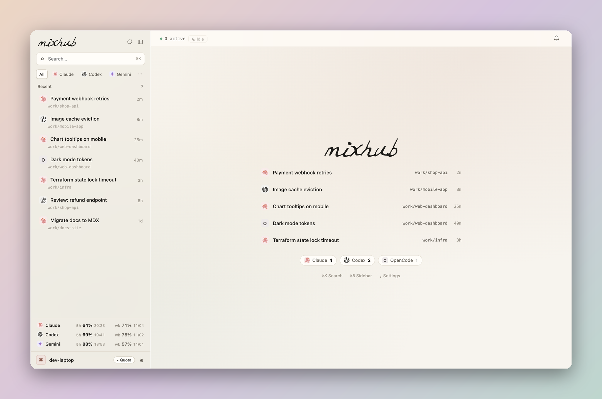

<div align="center">

# MixHub

**A terminal sidebar for your Claude Code, Codex, Gemini and OpenCode sessions**

[](#license)
[](#install)
[](#architecture)

</div>

MixHub is a tmux workspace that lists every coding-agent session on your machine, including the ones you started in other terminal tabs, and shows whether each one is working, waiting for you or done. Click a session and its real CLI opens on the right. The others keep running in the background.

```bash
pipx install mixhub-cli    # or: uv tool install mixhub-cli
mixhub
```

Early, used daily on macOS with around a dozen sessions. Linux works but gets less testing. Needs Python 3.10+ and tmux.

https://github.com/user-attachments/assets/3c068cd5-b168-4b5c-96a0-208c8a6a908d

## Why

I usually have several agents going at once, often from different vendors. I kept missing the one that had been sitting on a permission prompt for ten minutes, and losing sessions I had started in some other tab. A terminal tab shows a title, not whether the agent behind it is stuck. MixHub works that out from each agent's own session files and puts all of them in one list.

What it does:

- Lists sessions from Claude Code, Codex, Gemini (Antigravity CLI) and OpenCode, wherever they were started.
- Marks each one as working, waiting for approval, done or unread. Status comes from the agents' session files; reading the screen is only a fallback.
- Runs the unmodified CLI in the right pane. Switching sessions switches a tmux window, so nothing is interrupted.
- Shows 5-hour and weekly quota for each agent at the bottom of the sidebar.
- Rings the terminal when a session finishes or starts waiting while you're elsewhere.

What it doesn't do: it doesn't create worktrees or touch git, doesn't patch the agents, and doesn't send anything off your machine unless you set up a notification channel (otherwise the only network call is a daily update check, which you can turn off). It uses its own private tmux servers, so your own tmux config and sessions are left alone.

## Similar tools

| | Agents | Runs in | Git worktrees | Per-session status | Sessions started elsewhere |
| :--- | :--- | :--- | :--- | :--- | :--- |
| MixHub | Claude Code, Codex, Gemini, OpenCode | any terminal (needs tmux) | no | from session files | listed |
| [Claude Code Agent View](https://code.claude.com/docs/en/agent-view) | Claude Code | the `claude` CLI | background sessions by default | yes | only after `/bg` or `claude --bg` |
| [cmux](https://github.com/manaflow-ai/cmux) | Claude Code, Codex, OpenCode, Gemini, Amp and more | its own macOS app | no | notifications via hooks / OSC | not documented |
| [claude-squad](https://github.com/smtg-ai/claude-squad) | Claude Code, Codex, Gemini, Aider | any terminal (needs tmux) | one per session | not documented | no, manages its own |
| [ccmanager](https://github.com/kbwo/ccmanager) | Claude Code, Codex, Gemini, OpenCode and more | any terminal | yes, managed in the app | busy / waiting / idle | not documented |
| [agent-deck](https://github.com/asheshgoplani/agent-deck) | Claude Code, Codex, Gemini, OpenCode and more | any terminal (tmux) | optional | running / waiting / idle | its own tmux sessions |
| [tmux-agent-status](https://github.com/samleeney/tmux-agent-status) | Claude Code, Codex, Devin | inside your tmux | no | via agent hooks | inside tmux |

If you only use Claude Code, Agent View is built in. If you want a worktree per task, claude-squad and ccmanager do that and MixHub doesn't.

## Install

Requirements: Python 3.10+ and `tmux` (developed on tmux 3.6).

| Platform | Status |
| :--- | :--- |
| macOS | Supported |
| Linux, Windows via WSL | Experimental: the workspace, web workbench and CLI work; Terminal.app tab switching and the Dock badge are macOS-only |
| Native Windows | Not supported; run MixHub inside WSL |

```bash
curl -fsSL https://raw.githubusercontent.com/ShinoKana/mixhub/main/install.sh | sh
```

The script installs the `mixhub-cli` package (it provides the `mixhub` command) with uv, pipx or a private venv (whichever it finds first) and tells you if Python 3.10+ or tmux is missing. Installing it yourself works the same: `uv tool install mixhub-cli` or `pipx install mixhub-cli`.

```bash
mixhub           # open or reattach to the workspace
mixhub web       # local web workbench at http://127.0.0.1:8765
mixhub doctor    # check agent CLIs, tmux, notification channels and terminal settings
```

From a clone:

```bash
git clone https://github.com/ShinoKana/mixhub.git
ln -sf "$PWD/mixhub/bin/mixhub" ~/.local/bin/mixhub
```

### Updating

```bash
mixhub update          # upgrade, then reload the sidebar, reader and web daemon on the new code
mixhub update --check  # only say whether a newer version exists
```

`mixhub update` uses whatever installed MixHub: `uv tool upgrade`, `pipx upgrade`, `pip install --upgrade` inside install.sh's venv, or `git pull --ff-only` in a clone. Running agent sessions are not interrupted. MixHub never updates itself: once a day it asks PyPI for the latest version in the background and, when there is a newer one, prints a one-line hint from `mixhub web`, `mixhub doctor` and the workspace's exit message. Set `"update_check": false` in Preferences or `MIXHUB_NO_UPDATE_CHECK=1` to turn the check off.

## Supported agents

| Agent | Sessions read from | Resume |
| :--- | :--- | :--- |
| Claude Code | `~/.claude/projects/**.jsonl` | `claude --resume <id>` |
| Gemini via AGY | AGY conversation store | `agy --conversation <id>` |
| Codex | `~/.codex/sessions/` rollouts + state DB | `codex resume <id>` |
| OpenCode | `opencode.db` (read-only) | `opencode -s <id>` |

`✎ New session` opens the new session in the working directory of the session selected in the sidebar, so to start in a project folder, click one of that folder's sessions first. With nothing selected it uses the folder you ran `mixhub` from. It can also start Claude Code with another model behind it (DeepSeek, Kimi, Qwen and GLM presets); the badge shows which model a session uses.

## The workspace

**Sidebar.** Sessions are grouped into `Pinned`, `Active` (sessions you are working with) and `Recent`. A row shows the agent's brand-colored badge, the title the agent itself gave the session, and its age. The badge animates while the agent is working; when the agent needs approval or an answer it stops, turns bold amber, and the age turns yellow. Unread replies are bold. `▾ mixhub` filters by agent, `‹ ›` walks back and forward through what you looked at, `◧` collapses the sidebar. Hover a row to pin it. The sidebar is entirely click-driven; keys go to the agent. Subagent runs, headless or scripted runs, and sessions whose working directory is under `/tmp` are not listed.

**Right pane.** Clicking a session that is running in MixHub switches to its live CLI window. Clicking any other session shows a read-only transcript preview with a turn minimap; `[ Resume ↵ ]` starts the CLI in place, and `[ Go to Tab ]` jumps to a session that is running in another Terminal tab. Each live window has a two-row header with the working directory, session id and title.

**Home.** With nothing selected, the right pane holds a plain login shell under the preview, for quick commands without leaving the workspace. Clear it the usual way (`clear` or Ctrl+L).

**Footer.** Used `5h` and weekly quota with reset times for each agent that has at least one session on this machine, plus CPU and memory. Codex quota comes from its own session files. For exact Claude Code and Gemini (AGY) numbers, point their status line at MixHub, which records the quota each agent reports and prints a short status line back:

```jsonc
// ~/.claude/settings.json
"statusLine": {"type": "command", "command": "mixhub statusline claude"}

// ~/.gemini/antigravity-cli/settings.json
"statusLine": {"type": "command", "command": "mixhub statusline agy", "enabled": true}
```

Without it the footer estimates Claude's quota from transcripts.

**OpenCode tabs.** OpenCode keeps several sessions in one process. MixHub follows the tab you are on: the window is renamed to that session, and other tabs show a preview and open in their own window when resumed.

**Attention.** When a session finishes a turn or starts waiting while you are elsewhere, MixHub rings the outer terminal once, so Terminal.app shows a Dock badge and a counter in the window title.

**Crash recovery.** `mixhub shell-hook` prints a zsh snippet for `~/.zshrc`. If Terminal restores the window MixHub was in after a crash or forced quit, the snippet reattaches it.

## Session lifecycle

MixHub separates whether a session is listed as `Active` from whether its process is running. Sessions keep running until you `/exit` them or close them from the sidebar. To have idle ones put to sleep (process stopped, session kept in `Active`, resumed in place when you click it), set `auto_sleep_hours` in `Preferences`; it is off by default.

A session is never put to sleep while it is working or waiting for approval, has running subagents or open background tasks, or has user processes running on its terminal. If the process table can't be read, nothing is put to sleep. Only sessions running in MixHub's own windows are ever put to sleep, automatically or from the web; an agent you started in another terminal is listed but never stopped. `/exit` in the agent moves the session to `Recent`; a system shutdown keeps `Active` as it was.

On macOS, while an agent is working and the Mac runs on power, MixHub keeps it from idle-sleeping (`caffeinate -i`, released when the work ends; never on battery).

## Handoff between agents

When one agent runs out of quota or you want a second opinion, `mixhub handoff` writes a compact handoff bundle (under 2,000 tokens, ten sections: goal, acceptance criteria, decisions, rejected approaches, your verbatim constraints, git and file state, verification commands, open questions, next action, evidence pointers) plus a machine-readable `handoff.yaml`, and starts the target agent with it:

```bash
mixhub handoff SESSION_ID --to codex --mode delegate
mixhub handoff SESSION_ID --to claude --mode review
mixhub handoff SESSION_ID --to agy --dry-run
```

The new session is titled `↳ <source title>`.

## Web workbench and notifications

<picture>
  <source media="(prefers-color-scheme: dark)" srcset=".github/assets/web-dark.png">
  
</picture>

- `mixhub web` serves a loopback-only web UI: search across all sessions and full transcripts. The terminal workspace is where MixHub gets used day to day; the web workbench sees much less use and has rougher edges, so please [open an issue](../../issues) when something there looks wrong.
- `mixhub notify` sends a one-way message to Telegram, a Slack incoming webhook or any URL that takes a JSON POST. It only tells you something happened; replying and approving stay in the agents' own remote control.

### Notification channels

Nothing is sent until you set up a channel in `~/.config/mixhub/channels.json`. Every section is optional:

```json
{
  "telegram": {
    "bot_token": "123456:ABC...",
    "chat_id": -1001234567890,
    "topics": {"builds": 42, "reviews": 57},
    "default_topic": "builds",
    "routing_rules": {"reviews": ["review", "pr"]}
  },
  "slack": {"webhook_url": "https://hooks.slack.com/services/..."},
  "webhook": {"url": "https://example.com/mixhub", "headers": {"Authorization": "Bearer ..."}}
}
```

- Telegram goes through the Bot API (`sendMessage`, plus `sendDocument` for an attached file). `topics` maps forum topic names to thread ids. A message goes to the topic you name with `--topic`, else the first topic whose `routing_rules` keyword appears in the session's folder, title or the message, else `default_topic`, else the chat itself. To send through your own command instead, set `"tgnotify_bin"`. It is called as `<bin> -t <topic> [--alert] [--file F] <text>`.
- Slack posts to the channel the incoming webhook belongs to.
- `webhook` receives `{"text", "title", "session_id", "tool", "topic"}`.

The notification settings in the web workbench (the bell) show which channels are set up and send a test message.

```bash
mixhub notify "Deploy finished"                  # every configured channel
mixhub notify --channel telegram --topic builds --alert "Tests failed"
mixhub notify --session 1a2b3c                   # a short card about that session
```

To hear when an agent needs you or finishes a turn, add the agents' own hooks. `mixhub notify --print-hooks` prints both snippets with the full path to `mixhub`:

- Claude Code (`~/.claude/settings.json`): `Notification` and `Stop` hooks running `mixhub notify --hook claude`. You get the prompt Claude is waiting on, or the start of its last reply.
- Codex (`~/.codex/config.toml`): `notify = ["mixhub", "notify", "--hook", "codex"]`, which sends the last reply after each turn.

A hook sends to every configured channel, sends nothing when none is configured, and always exits 0.

## Language

The web workbench, terminal messages and handoff bundles are in English, Chinese or Japanese. Terminal text and handoff bundles use `MIXHUB_LANGUAGE`, else `"language"` in Preferences (`"auto"`, `"en"`, `"zh"`, `"ja"`), else your locale. The web workbench uses the language picked in its settings (`,`), else the Preferences language, else your browser's. Notifications follow the language you write to the agent in. Text missing in a language falls back to English.

Translations are one JSON file per language in [`mixhub/i18n/`](mixhub/i18n). To add a language, copy `en.json` to `<code>.json`, translate the values (keep the `{placeholders}`), and add the code to `LANGUAGES` in `mixhub/i18n/__init__.py`. Partial translations are fine.

## Security

The web workbench and its API listen on `127.0.0.1` only and have no login. They can read every transcript MixHub sees and type into running agent sessions, so treat the port like a shell:

- Other programs and other users on the same machine can reach it. Don't run MixHub on a shared machine you don't trust.
- Requests from websites in your browser are refused: the server checks the `Host` header (against DNS rebinding), `Origin` and `Sec-Fetch-Site`, only accepts JSON for anything that changes state, and sends a strict Content-Security-Policy.
- It only answers to `127.0.0.1` and `localhost`, so a reverse proxy or a forwarded port won't work, and shouldn't. To open it from another device, use an SSH tunnel (`ssh -L 8765:127.0.0.1:8765 your-machine`, then `http://localhost:8765`).
- Notification channels (Telegram, Slack, webhooks) send session titles and message text to those services. Nothing is sent unless you configure a channel.

MixHub reads the agents' transcripts and databases without changing them. It writes to agent files only when you ask it to: renaming a session (the title goes where that agent keeps titles, also while the session runs: a title record appended to a Claude transcript, a row updated in the Codex or Gemini database), workspace trust you opted into with `trust_all_workspaces` or `trust_roots` (so a resume doesn't stop at the trust prompt) and `mixhub sync-rules` (writes `.gemini/GEMINI.md` from `AGENTS.md`).

## Configuration

MixHub keeps its state (`data/`, `Preferences`, `hub_state.json`, the Web daemon's `.hub.pid` / `hub.log`) in one directory: `$MIXHUB_HOME` if set, otherwise the repository root when you run from a clone, otherwise `$XDG_DATA_HOME/mixhub` or `~/.local/share/mixhub`. Nothing is written next to an installed package.

Everything works without configuration. Optional settings live in a JSON file named `Preferences`, looked up at `$MIXHUB_PREFERENCES_PATH`, then `~/.config/mixhub/Preferences`, then the state directory:

```json
{
  "language": "auto",
  "host_label": "work-laptop",
  "trust_all_workspaces": false,
  "trust_roots": ["~/workspace"],
  "agy_mouse_shim": "auto",
  "dispatch_scripts": ["my-agent-runner"],
  "update_check": true,
  "auto_sleep_hours": 0
}
```

[`Preferences.example`](Preferences.example) lists every option. Environment variables:

| Variable | Effect |
| :--- | :--- |
| `MIXHUB_HOME` | State directory |
| `MIXHUB_PREFERENCES_PATH` | Preferences file |
| `MIXHUB_PORT` | Web workbench port (default `8765`) |
| `MIXHUB_LANGUAGE` | Interface language, over Preferences and the locale |
| `MIXHUB_NO_OPEN=1` | `mixhub web` starts the daemon without opening a browser |
| `MIXHUB_NO_UPDATE_CHECK=1` | No daily update check |

`host_label` is the machine name shown in the web workbench (the hostname by default). `dispatch_scripts` names your own wrapper scripts that start agents headlessly, so their sessions are not mistaken for interactive ones. Prompts that your own automation sends can be hidden from the list with `data/local_rules.json` (`automated_prefixes`, `automated_substrings`). Notes your own tools type into an agent on another agent's behalf go in `relayed_prefixes`: they never count as you having used a session, but don't hide one either.

## Architecture

Python standard library only. The code lives in the `mixhub` package:

| Package | Responsibility |
| :--- | :--- |
| `mixhub/hub` | Session discovery per agent, transcript parsing, process binding, lifecycle and sleep guards, working set |
| `mixhub/providers` | Per-agent launch and resume commands, quota reading, native title sync, harness presets |
| `mixhub/tui` | The curses sidebar, preview reader and window header (`HubTUI`, composed from one mixin per concern) |
| `mixhub/tmux` | The two tmux servers: outer workspace, the `hubpool` window pool, headers, home shell |
| `mixhub/handoff` | Handoff extraction and rendering |
| `mixhub/channels` | One-way notifications: Telegram Bot API, Slack incoming webhook |
| `mixhub/probe` | Reading an agent's screen: working, waiting for approval, menus |
| `mixhub/proc` | Process identity and classification, safe-kill guards |
| `mixhub/rules` | Shared agent rules compiler and workspace trust |
| `mixhub/filters/agy_claude` | Optional PTY filter for AGY (theme, cursor, mouse) |
| `mixhub/web` | Loopback HTTP API and assets for the web workbench |
| `mixhub/cli` | The `mixhub` command |
| `mixhub/core` | Shared paths, launch commands, preferences, session states |

State (pins, working set, caches, logs) lives in `~/.local/share/mixhub` for an installed package, or next to the code in a git checkout; set `MIXHUB_HOME` to put it elsewhere.

The workspace is two private tmux servers, neither of them your default one, so MixHub's sessions, options, key bindings and hooks never reach your own tmux. The outer session (`tmux -L mixhub`) holds the sidebar on the left and, on the right, a client of `tmux -L hubpool`, where every live agent runs in its own window. Switching sessions switches that window, so agents keep running untouched while you look elsewhere. Run `mixhub` inside your own tmux and the workspace opens nested in that pane.

## Roadmap

- An agent-facing command set (list sessions, read another session's recent turns) and a skill so agents can use MixHub themselves.
- Broader Linux polish.

## Development

```bash
python3 -m pytest -q
```

`python3 scripts/demo_seed.py ~/.cache/mixhub-demo --web 8799` serves the web workbench on made-up sessions, which is how the screenshots are taken.

The tests never touch your real sessions or tmux servers: every state path is redirected to a temp directory and tmux tests use private sockets. `tests/test_oss_desensitize_and_cc_ds.py` checks every tracked file for personal paths and names.

## License

MIT
